# ClawdIsland

A small orange pet that lives in your MacBook notch and mirrors what Claude Code is doing.

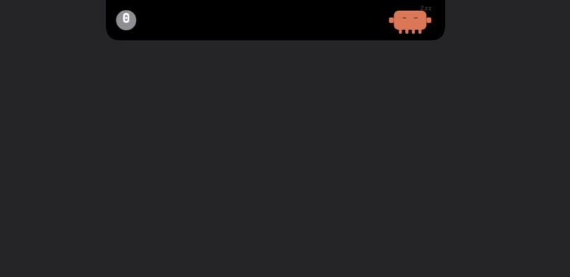


## Install from a release

Needs macOS 14+ on Apple silicon and Claude Code.

1. Download `ClawdIsland-<version>.zip` and `ClawdIsland-<version>.zip.sha256` from the [Releases page](../../releases).
2. Check the download, in the download folder: `shasum -a 256 -c ClawdIsland-<version>.zip.sha256` must print `OK`.
3. Unzip it and move `ClawdIsland.app` to `/Applications` (or `~/Applications`).
4. Open it. The app is signed but not notarized, so macOS blocks the first launch. On macOS 15+ open System Settings → Privacy & Security and click **Open Anyway** next to ClawdIsland (on macOS 14, right-click the app → Open). Or clear the quarantine flag: `xattr -dr com.apple.quarantine /Applications/ClawdIsland.app`.
5. Settings opens on the first launch: click **Install** in the hooks row. It backs up `~/.claude/settings.json`, adds the hooks and the statusline, and can be undone from the same row (**Uninstall**). Settings is also in the right-click menu of the notch.

To update, quit ClawdIsland and replace the app with the new one. Releases share one signing identity, so the permissions below survive updates.

### Permissions

- **Automation** (Terminal.app, iTerm2): macOS asks the first time you click a session; allow it for tab-precise focus.
- **Accessibility**: for VS Code and JetBrains window focus. Add ClawdIsland in System Settings, Privacy & Security, Accessibility.
- **Login item**: toggle "Launch at login" in Settings.

### Uninstall

Click **Uninstall** in the Settings hooks row (it restores your previous statusline), quit the app, then delete `ClawdIsland.app` and `~/Library/Application Support/ClawdIsland/`. From a source checkout, `scripts/uninstall.sh` does all of that (pass `--dest /Applications` if you installed there).

## Features

- **Notch island.** An asymmetric island around the notch: a session counter in the left wing, an HP bar and the pet in the right wing. On a Mac without a notch it draws a virtual one at the top of the main display. On hover the counter morphs into three counters.
- **Usage from the statusline.** HP is your 5-hour usage and WK your weekly usage, both read from the Claude Code statusline `rate_limits` payload.
- **Session panel.** Hover the island to open the panel: sessions sorted by importance, each with a state dot and the session's context use and cost (`ctx 64% · $1.20`, from the statusline), plus the usage footer.
- **Focus on click.** Jump to the terminal or IDE of a session:

  | App | Focus precision |
  |---|---|
  | Terminal.app, iTerm2 | the exact tab |
  | VS Code family, JetBrains IDEs | the window |
  | Ghostty, Warp | the app |

- **Permissions from the notch.** Answer Claude Code permission requests with Deny, Allow or Always allow, without switching windows.
- **"+ New" session.** Start a new Claude Code session from the panel.
- **Mini mode.** The pet hangs upside down from the notch's bottom-right corner and pops out when Claude finishes or needs you, staying out until you read the session or answer it; when Claude writes for a while it pops out for 3 s. Other state changes only re-pose the peeking pet.

  

- **Sound cues** for needs-input and done.
- **Do Not Disturb.** One toggle (right-click menu or Settings) mutes pop-outs and sounds; the counters still update.
- **Two styles and a poke.** Pick Roundy or Sharpy in Settings → Pet, with a live preview. Click the pet to poke it.
- **Settings** in three tabs: General, Pet and Advanced (port, version, link to this repository).
- **JetBrains Mono** for the numbers, with a monospaced fallback.

## Poses

Every pose is a Core Animation layer loop run by the render server. The GIFs are rendered offscreen by the app itself, in both styles.

| State | Trigger | Roundy | Sharpy |
|---|---|---|---|
| `sleeping` | no sessions | 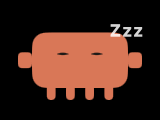 | 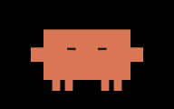 |
| `idle` | session waiting for a prompt |  | 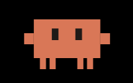 |
| `thinking` | prompt submitted, between tool calls | 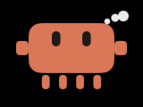 | 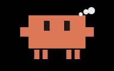 |
| `usingTools` | a tool is running |  | 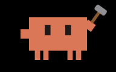 |
| `talking` | Claude is writing text | 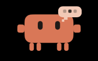 | 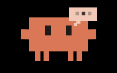 |
| `compacting` | context compaction |  | 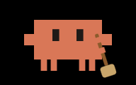 |
| `juggling` | subagents running |  | 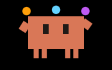 |
| `done` | turn finished |  | 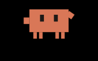 |
| `needsInput` | permission or question waiting |  | 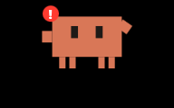 |

## Requirements

- macOS 14 or later (tested on macOS 26), Apple silicon.
- Claude Code with hooks and the statusline.
- A Claude Pro or Max plan for HP and WK (the usage data is only sent on those plans).

## Build from source

You need the Swift 6.2 Command Line Tools (`xcode-select --install`); Xcode is not needed.

```sh
git clone <this repo> && cd <repo folder>
scripts/make-signing-cert.sh   # optional, once: a local "ClawdIsland" certificate so permissions survive rebuilds
scripts/install.sh             # release build -> ~/Applications/ClawdIsland.app, then launches it
```

`scripts/test.sh` runs the tests, `scripts/run.sh` builds and launches a debug bundle, and `scripts/package.sh` makes the release zip and its `.sha256`. The other scripts, the spec in [`docs/`](docs/) and the agent guide are described in [`CLAUDE.md`](CLAUDE.md).

## Privacy

Everything stays on your Mac. The app listens on `127.0.0.1` only and checks a token on every request. It never reads the Keychain, OAuth tokens or Claude Code credentials; usage comes only from the statusline payload.

## Credits and license

The look is inspired by Anthropic's Clawd mascot. All art is drawn from scratch as vector layers; no assets are copied.

License: [MIT](LICENSE). The bundled JetBrains Mono font is under the SIL Open Font License 1.1, see [THIRD_PARTY_NOTICES.md](THIRD_PARTY_NOTICES.md). Release notes are in [CHANGELOG.md](CHANGELOG.md).
