# ClawdNotch

A small orange pet that lives in your MacBook notch and mirrors what Claude Code is doing.

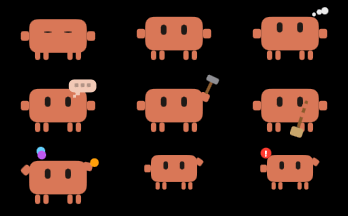

> **Status: in development; installation instructions will come before the first release.**

## Features

- **Notch island.** An asymmetric island around the notch: a session counter in the left wing, an HP bar and the pet in the right wing. On a Mac without a notch it draws a virtual one at the top of the main display. On hover the counter morphs into three counters.
- **Usage from the statusline.** HP is your 5-hour usage and WK your weekly usage, both read from the Claude Code statusline `rate_limits` payload.
- **Session panel.** Hover the island to open the panel: sessions sorted by importance, each with a state dot, plus the usage footer.
- **Focus on click.** Jump to the terminal or IDE of a session:

  | App | Focus precision |
  |---|---|
  | Terminal.app, iTerm2 | the exact tab |
  | VS Code family, JetBrains IDEs | the window |
  | Ghostty, Warp | the app |

- **Permissions from the notch.** Answer Claude Code permission requests with Deny, Allow or Always allow, without switching windows.
- **"+ New" session.** Start a new Claude Code session from the panel.
- **Hide mode.** The pet hangs upside down from the notch's bottom-right corner and pops out for 3 s when Claude starts writing, finishes, needs you or runs subagents; other state changes only re-pose the peeking pet. A pending permission request stays out until you resolve it.
- **Sound cues** for needs-input and done.
- **Music headphones.** The pet puts on headphones and nods while Apple Music or Spotify plays (switch in Settings).
- **JetBrains Mono** for the numbers, with a monospaced fallback.

## Poses

Every pose is a Core Animation layer loop run by the render server. The GIFs are rendered offscreen by the app itself.

| State | Trigger | Pose | With headphones |
|---|---|---|---|
| `sleeping` | no sessions |  | 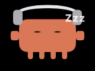 |
| `idle` | session waiting for a prompt | 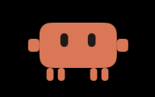 | 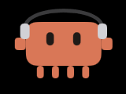 |
| `thinking` | prompt submitted, between tool calls |  | 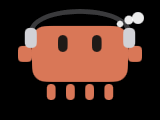 |
| `usingTools` | a tool is running |  | 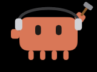 |
| `talking` | Claude is writing text |  | 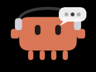 |
| `compacting` | context compaction |  | 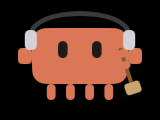 |
| `juggling` | subagents running |  | 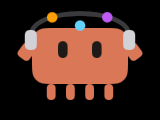 |
| `done` | turn finished |  | 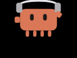 |
| `needsInput` | permission or question waiting |  | 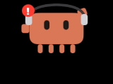 |

Headphones are independent of the state: they appear on top of any pose while music plays. The cups sit on the body's upper corners, clear of the raised paw, and the nod only shows in the calm poses.

## Requirements

- macOS 14 or later (tested on macOS 26), Apple silicon.
- Claude Code with hooks and the statusline.
- A Claude Pro or Max plan for HP and WK (the usage data is only sent on those plans).
- Swift 6.2 Command Line Tools to build. Xcode is not needed.
- Optional permissions:
  - Automation for Terminal.app and iTerm2, for tab-precise focus.
  - Accessibility for VS Code and JetBrains window focus.
  - A login item, to start with your Mac.
- JetBrains Mono is optional; without it the app uses the system monospaced font.

## Development

| Command | Purpose |
|---|---|
| `swift build` | Build all targets (debug) |
| `scripts/test.sh` | Run `ClawdCoreTests` (wraps `swift test`; with Command Line Tools only, plain `swift test` silently runs nothing) |
| `scripts/bundle.sh [debug\|release]` | Assemble and ad-hoc sign `dist/ClawdNotch.app` |
| `scripts/run.sh` | Kill the running instance, bundle debug, launch |
| `scripts/simulate.sh <scenario>` | POST fake Claude Code hook events to the running app |
| `scripts/perf.sh [seconds]` | Sample CPU and RSS of the running app against the budget |
| `swift scripts/window-info.swift` | Print screens and the app's window level and bounds |

To regenerate the pose GIFs, build in debug and run `.build/debug/ClawdNotch --render-poses docs/media`. The mode exists only in debug builds. The agent guide is [`CLAUDE.md`](CLAUDE.md).

## Docs
| | |
|---|---|
| [01 Vision](docs/01-vision.md) | what and why |
| [02 Requirements](docs/02-requirements.md) | REQ-xx with acceptance criteria |
| [03 Architecture](docs/03-architecture.md) | targets, types, data flow |
| [04 State machine](docs/04-state-machine.md) | hook event → pet state |
| [05 Claude Code integration](docs/05-claude-code-integration.md) | hooks, bridge, statusline, installer |
| [06 Window & notch](docs/06-window-and-notch.md) | NSPanel, geometry, hide mode |
| [07 Pet design](docs/07-pet-design.md) | tokens, anatomy, animations |
| [08 Performance](docs/08-performance.md) | budget and rules |
| [09 Roadmap](docs/09-roadmap.md) | work packages |
| [10 Code style](docs/10-code-style.md) | clean code and comments |
| [ADRs](docs/adr/) | key decisions |

## Privacy

Everything stays on your Mac. The app listens on `127.0.0.1` only and checks a token on every request. It never reads the Keychain, OAuth tokens or Claude Code credentials; usage comes only from the statusline payload.

## Credits and license

The look is inspired by Anthropic's Clawd mascot. All art is drawn from scratch as vector layers; no assets are copied.

License: TBD.
