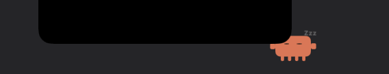
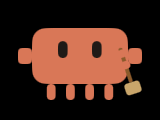
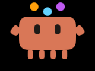
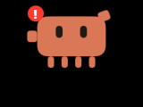

# ClawdNotch

A small orange pet that lives in your MacBook notch and mirrors what Claude Code is doing.


## Install

ClawdNotch is built from source. You need macOS 14+ and the Swift 6.2 Command Line Tools (`xcode-select --install`); Xcode is not needed.

```sh
git clone <this repo> && cd claude-pet
scripts/make-signing-cert.sh   # once: creates the "ClawdNotch Dev" certificate, asks for your login password
scripts/install.sh             # release build -> ~/Applications/ClawdNotch.app, then launches it
```

`scripts/install.sh --dest /Applications` installs for all users. Without the certificate the app is signed ad-hoc, which works, but macOS forgets the permissions below after every rebuild. A signed app is a stable identity, so the grants survive updates. The certificate is local to your Mac (ADR-0008); other Macs see an "unidentified developer" warning (right-click, Open).

Then open **Settings** (right-click the notch → Settings…) and click **Install Hooks**. It backs up `~/.claude/settings.json`, adds the hooks and the statusline, and can be undone from the same place (**Uninstall Hooks**).

### First-run permissions

- **Automation** (Terminal.app, iTerm2): macOS asks the first time you click a session; allow it for tab-precise focus.
- **Accessibility**: for VS Code and JetBrains window focus. Add ClawdNotch in System Settings, Privacy & Security, Accessibility.
- **Login item**: toggle "Launch at login" in Settings.

### Updating

Pull and re-run `scripts/install.sh`, then click **Install Hooks** in Settings again if the install folder changed (hooks point at the app's bridge path; re-installing replaces the old entries).

### Uninstall

`scripts/uninstall.sh` (add `--dest` if you installed elsewhere, `--yes` to skip the question) removes the hooks and restores your previous statusline, then deletes the app and `~/Library/Application Support/ClawdNotch/`.

### Share a build

`scripts/package.sh` writes `dist/ClawdNotch-<version>.zip` and its `.sha256`.

## Features

- **Notch island.** An asymmetric island around the notch: a session counter in the left wing, an HP bar and the pet in the right wing. On a Mac without a notch it draws a virtual one at the top of the main display. On hover the counter morphs into three counters.
- **Usage from the statusline.** HP is your 5-hour usage and WK your weekly usage, both read from the Claude Code statusline `rate_limits` payload.
- **Session panel.** Hover the island to open the panel: sessions sorted by importance, each with a state dot, plus the usage footer.
- **Focus on click.** Jump to the terminal or IDE of a session:

  | App | Focus precision |
  |---|---|
  | Terminal.app, iTerm2 | the exact tab |
  | VS Code family, JetBrains IDEs | the window |
  | Ghostty, Warp | the app |

- **Permissions from the notch.** Answer Claude Code permission requests with Deny, Allow or Always allow, without switching windows.
- **"+ New" session.** Start a new Claude Code session from the panel.
- **Mini mode.** The pet hangs upside down from the notch's bottom-right corner and pops out for 3 s when Claude starts writing, finishes, needs you or runs subagents; other state changes only re-pose the peeking pet. A pending permission request stays out until you resolve it.

  

- **Sound cues** for needs-input and done.
- **JetBrains Mono** for the numbers, with a monospaced fallback.

## Poses

Every pose is a Core Animation layer loop run by the render server. The GIFs are rendered offscreen by the app itself.

| State | Trigger | Pose |
|---|---|---|
| `sleeping` | no sessions |  |
| `idle` | session waiting for a prompt |  |
| `thinking` | prompt submitted, between tool calls |  |
| `usingTools` | a tool is running |  |
| `talking` | Claude is writing text |  |
| `compacting` | context compaction |  |
| `juggling` | subagents running |  |
| `done` | turn finished |  |
| `needsInput` | permission or question waiting |  |

## Requirements

- macOS 14 or later (tested on macOS 26), Apple silicon.
- Claude Code with hooks and the statusline.
- A Claude Pro or Max plan for HP and WK (the usage data is only sent on those plans).
- Swift 6.2 Command Line Tools to build. Xcode is not needed.
- Optional permissions:
  - Automation for Terminal.app and iTerm2, for tab-precise focus.
  - Accessibility for VS Code and JetBrains window focus.
  - A login item, to start with your Mac.
- JetBrains Mono is bundled; if it fails to load the app uses the system monospaced font.

## Development

| Command | Purpose |
|---|---|
| `swift build` | Build all targets (debug) |
| `scripts/test.sh` | Run `ClawdCoreTests` (wraps `swift test`; with Command Line Tools only, plain `swift test` silently runs nothing) |
| `scripts/bundle.sh [debug\|release]` | Assemble and sign `dist/ClawdNotch.app` ("ClawdNotch Dev" if present, else ad-hoc) |
| `scripts/run.sh` | Kill the running instance, bundle debug, launch |
| `scripts/make-signing-cert.sh` | Create the local signing certificate (once) |
| `scripts/install.sh`, `uninstall.sh`, `package.sh` | Install, remove, zip (see Install) |
| `scripts/simulate.sh <scenario>` | POST fake Claude Code hook events to the running app |
| `scripts/perf.sh [seconds]` | Sample CPU and RSS of the running app against the budget |
| `scripts/perf-suite.sh` | Every performance scenario on a release bundle, one table |
| `scripts/record-gif.sh <island\|hide-mode>` | Record the README island / hide-mode GIFs |
| `swift scripts/window-info.swift` | Print screens and the app's window level and bounds |

To regenerate the pose GIFs, build in debug and run `.build/debug/ClawdNotch --render-poses docs/media`. The mode exists only in debug builds.

To try the hook uninstaller safely, point it at scratch copies: `CLAWD_SETTINGS_PATH=/tmp/settings.json CLAWD_CONFIG_PATH=/tmp/config.json dist/ClawdNotch.app/Contents/MacOS/ClawdNotch --uninstall-hooks` (it never touches `~/.claude` then). The agent guide is [`CLAUDE.md`](CLAUDE.md).

## Docs
| | |
|---|---|
| [01 Vision](docs/01-vision.md) | what and why |
| [02 Requirements](docs/02-requirements.md) | REQ-xx with acceptance criteria |
| [03 Architecture](docs/03-architecture.md) | targets, types, data flow |
| [04 State machine](docs/04-state-machine.md) | hook event → pet state |
| [05 Claude Code integration](docs/05-claude-code-integration.md) | hooks, bridge, statusline, installer |
| [06 Window & notch](docs/06-window-and-notch.md) | NSPanel, geometry, mini mode |
| [07 Pet design](docs/07-pet-design.md) | tokens, anatomy, animations |
| [08 Performance](docs/08-performance.md) | budget and rules |
| [09 Roadmap](docs/09-roadmap.md) | work packages |
| [10 Code style](docs/10-code-style.md) | clean code and comments |
| [ADRs](docs/adr/) | key decisions |

## Privacy

Everything stays on your Mac. The app listens on `127.0.0.1` only and checks a token on every request. It never reads the Keychain, OAuth tokens or Claude Code credentials; usage comes only from the statusline payload.

## Credits and license

The look is inspired by Anthropic's Clawd mascot. All art is drawn from scratch as vector layers; no assets are copied.

License: [MIT](LICENSE). The bundled JetBrains Mono font is under the SIL Open Font License 1.1, see [THIRD_PARTY_NOTICES.md](THIRD_PARTY_NOTICES.md). Release notes are in [CHANGELOG.md](CHANGELOG.md).
